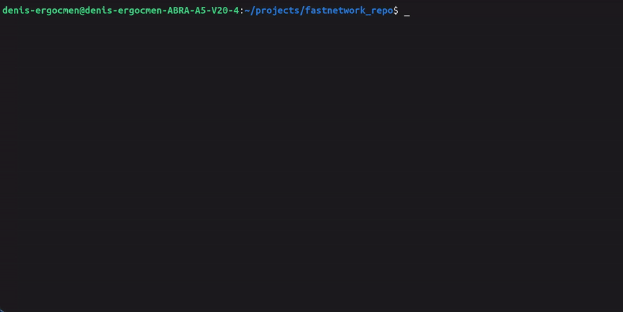

# fastnetwork

**An internet speed test for the terminal that also tells you *why* the network is bad.**

Made for cafés, hotels, co-working spaces and other shared Wi-Fi.
One file. No dependencies. Just Python 3.



```
$ fastnetwork
fastnetwork  (normal test)
  Example ISP  |  Istanbul, TR  |  server IST  |  IP 203.0.113.42

  Ping     18 ms   jitter 3 ms   lost 0 %

  Download
  Download   1s   now   41.2 Mbps   avg measuring...
  Download   2s   now   47.9 Mbps   avg measuring...
  Download   3s   now   48.3 Mbps   avg   48.1 Mbps
  ...
Download: [ 58%] [##############################.....................] 48.3 Mbps  (avg 48.1 Mbps)
```

While the test runs, a status bar stays fixed at the bottom of the terminal
(like the progress bar of `apt upgrade`), and live readings scroll above it.
When the test ends, you get a summary:

```
----------------------------------------------------
  Download       48.1 Mbps   Fast
  Upload         12.4 Mbps   Fast
  Ping               18 ms   Excellent
  Jitter              3 ms   Stable
  Lost pings          0 %
  Busy ping         210 ms
  Data used          78 MB
----------------------------------------------------
  What works here:
    YES  Web, email, music
    YES  HD video (1080p)
    YES  4K video
    YES  Video calls
    NO   Online games
    YES  Sending big files
----------------------------------------------------
  Status: GOOD - Good for work, calls and video.
  ! When the internet is busy, it becomes slow to answer. Calls lag if someone downloads.
```

## Why another speed test?

Most speed tests give you numbers. When something is wrong, they show an error
and stop. `fastnetwork` tries to answer the question you actually have:
*"Can I work here?"*

- **It finds the reason when the network does not work.** "No network",
  "no internet", "DNS is broken", "the Wi-Fi wants you to log in",
  "the connection dropped during the test" and more. Each one has a
  plain-English message, a tip and its own [exit code](#problems-and-exit-codes).
- **It measures *busy ping* (bufferbloat).** On shared Wi-Fi, this number
  often explains why video calls freeze even when the speed looks good.
- **It tells you what works.** Video calls, 4K video, online games and more,
  based on the results.
- **It runs the same test every time,** so you can compare places.
- **It has a mobile data mode** that uses about 13 MB.
- **It needs nothing to install.** One Python file, standard library only.

## Install

You need Python 3.7 or newer. It is already installed on most Linux systems.

```bash
sudo curl -fsSL https://raw.githubusercontent.com/Denisergocmen924/fastnetwork/main/fastnetwork \
     -o /usr/local/bin/fastnetwork
sudo chmod +x /usr/local/bin/fastnetwork
```

Or clone the repo and copy the file:

```bash
git clone https://github.com/Denisergocmen924/fastnetwork.git
sudo install -m 755 fastnetwork/fastnetwork /usr/local/bin/fastnetwork
```

Now you can run `fastnetwork` from any folder.

To uninstall:

```bash
sudo rm /usr/local/bin/fastnetwork
```

## Usage

```bash
fastnetwork            # full test, about 25 seconds
fastnetwork --mobile   # small test for mobile data, about 13 MB
fastnetwork --help     # explains every result in simple English
```

There are no other options.

## What the results mean

| Result | Meaning | Better |
|---|---|---|
| **Download** | How fast you get data: websites, videos, files. | Bigger |
| **Upload** | How fast you send data: video calls, sending files. | Bigger |
| **Ping** | Time for a small message to go to the server and come back. | Smaller |
| **Jitter** | How much the ping changes from one try to the next. High jitter = calls and games are not smooth. | Smaller |
| **Lost pings** | Pings that never came back. Anything above 0 % means the connection drops sometimes. | 0 % |
| **Busy ping** | Ping measured *while* the download and upload tests are running. If it is much higher than the normal ping, calls will lag whenever someone on the network downloads something. | Close to Ping |
| **Data used** | How much data the test used. | — |

Ratings:

| | Very slow / Very high | Slow / High | OK | Fast / Good | Very fast / Excellent |
|---|---|---|---|---|---|
| Download (Mbps) | under 1 | 1–5 | 5–25 | 25–100 | 100+ |
| Upload (Mbps) | under 1 | 1–3 | 3–10 | 10–50 | 50+ |
| Ping (ms) | 200+ | 100–200 | 50–100 | 20–50 | under 20 |

Jitter: under 10 ms is *Stable*, 10–30 ms is *A little unstable*, over 30 ms is *Unstable*.

Overall status:

| Status | Meaning |
|---|---|
| **EXCELLENT** | Everything works well, also games and 4K video. |
| **GOOD** | Good for work, video calls and HD video. |
| **BASIC** | OK for web and email. Calls and video may have problems. |
| **POOR** | The internet is very slow. |

## Problems and exit codes

If something goes wrong, `fastnetwork` tells you what happened and what to do.
The exit code is different for each problem, so you can use it in scripts.

| Code | Problem | What it means |
|---|---|---|
| 0 | OK | The test finished. |
| 1 | NOT CONNECTED | Your computer is not connected to any network. |
| 2 | NO INTERNET | You are connected to a network, but it has no internet. |
| 3 | DNS PROBLEM | The internet works, but website names cannot be found. |
| 4 | WI-FI LOGIN NEEDED | The Wi-Fi wants you to log in or accept rules first (captive portal). |
| 5 | HTTPS FAILED | A secure connection could not be made. The computer's clock may be wrong, or the network is changing your traffic. |
| 6 | TEST SERVER BLOCKED | The internet works, but this network blocks the test server. |
| 7 | SERVER BUSY | The test server said "too many requests" or had an error. |
| 8 | CONNECTION LOST | The connection stopped in the middle of the test. |
| 9 | TOO SLOW | Almost no data came. The connection is too slow to measure. |
| 10 | WRONG OPTION | You typed an option that does not exist. |
| 130 | CANCELLED | You pressed Ctrl+C. |

Example:

```bash
fastnetwork --mobile
case $? in
  0) echo "Network is OK" ;;
  4) xdg-open http://neverssl.com ;;   # open the Wi-Fi login page
  *) echo "Network problem" ;;
esac
```

## How the test works

The test is the same every time:

| Step | Normal | `--mobile` |
|---|---|---|
| 1. Check the network | network → DNS → Wi-Fi login page → test server | same |
| 2. Ping | 20 times | 10 times |
| 3. Download | 10 seconds, 6 connections | max 10 MB, 4 connections |
| 4. Upload | 10 seconds, 6 connections | max 3 MB, 4 connections |

Some details about accuracy:

- **Parallel connections.** One connection often cannot use the full speed of a fast line, so the test uses several at once.
- **Warm-up is not counted.** TCP connections start slowly. The first 2 seconds
  (1 second or the first 25 % of the data in mobile mode) are left out of the result.
- **Upload is counted when the server receives it,** not when it leaves the program.
  On Linux and macOS, `fastnetwork` asks the operating system how many bytes are
  still waiting to be sent and subtracts them. Without this, upload speeds
  would look too high.
- **Ping is an HTTPS round trip,** not an ICMP ping. Many public networks block
  ICMP. The server's own processing time (from the `Server-Timing` header) is
  subtracted, and the first request on each connection is not counted
  because it includes the TLS handshake.
- **Busy ping** is measured on a separate connection every 0.4 seconds
  while the download and upload tests are running.
- **Wi-Fi login pages** are found by asking
  `http://connectivitycheck.gstatic.com/generate_204`. A normal network
  answers `204 No Content`. A login page answers with something else.

**Data use:** in a normal test, every 10 Mbps of speed uses about 12.5 MB
(10 seconds of data). So a 100 Mbps download and a 100 Mbps upload use about
250 MB together. Use `--mobile` on mobile data.
`--mobile` is shorter, so its results are a little less exact on very fast connections.

## Test server

`fastnetwork` does **not** use fast.com, Netflix or Ookla. It uses
Cloudflare's public speed test endpoints at
[speed.cloudflare.com](https://speed.cloudflare.com), so you are tested against
the Cloudflare data center closest to you.

> **Note:** These endpoints (`/__down`, `/__up`, `/meta`) are what Cloudflare's
> own speed test web page uses. They are public, but they are **not an official,
> documented API.** Cloudflare can change them, limit them or turn them off at any
> time, and this tool could stop working. If you run many tests in a short time,
> Cloudflare may limit you; `fastnetwork` shows this as **SERVER BUSY (exit code 7)**.
> Please use it for normal, personal testing, not for automated tests every few
> seconds. This project is not affiliated with or endorsed by Cloudflare.

## Platform support

| System | Status |
|---|---|
| Linux | Tested |
| macOS | Should work, **not tested yet**. Reports are welcome. |
| Windows | Not tested. |

It works in any terminal that supports ANSI escape codes. If the output is not
a terminal (for example `fastnetwork > result.txt`), the status bar and colors
are turned off automatically. Colors are also turned off when `NO_COLOR` is set.

## Contributing

Issues and pull requests are welcome, especially:

- test results from macOS and Windows
- networks where `fastnetwork` gives the wrong problem message

Please keep it one file with no dependencies.

## License

[MIT](LICENSE)
